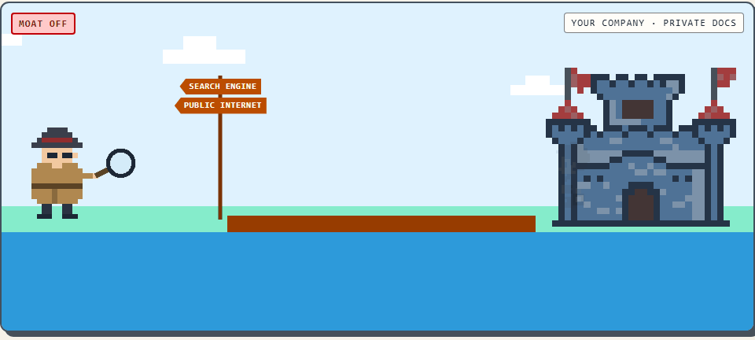

# MOAT Guard

**A privacy guard that sits between a deep-research agent and web search, and stops it from leaking your secrets one query at a time.**

<!-- TODO: replace with the recorded demo GIF (docs/demo.gif) -->


## Run in 60s

```
make demo    # → http://127.0.0.1:8000
```

No API key needed — it replays recorded runs by default.

**Windows:** `make` may not be installed. Run the three lines by hand instead:

```
uv sync
cd web && npm ci && npm run build && cd ..
uv run uvicorn api.main:app --host 127.0.0.1 --port 8000
```

## What it does

A deep-research agent reads internal battery-R&D docs and drafts web-search queries. MOAT Guard checks every outgoing query against the documents' secrets **and the full history of what's already been sent**, then **passes, rewrites, or blocks** it. A blocked query never reaches search. It stops two things a "do not disclose" prompt can't:

- **direct leaks** — a secret value appears in a query;
- **mosaic leaks** — individually-safe queries that together narrow a secret or fingerprint a product.

**Threat model:** the **search provider is the adversary** and sees only the queries; the LLM provider is trusted. Full model: [docs/THREAT_MODEL.md](docs/THREAT_MODEL.md).

## How Meta models are used

Muse Spark 1.3 via the Meta Model API powers three roles:

- **Agent** — drafts queries, reflects on results, writes the final report.
- **Tier 2 guard rewrite** — on escalation, rewrites a risky query to drop the leak (re-checked by Tiers 0–1 before it can go out).
- **Observer** — the attacker that reads the query log and tries to recover each secret, scoring how much leaked.

We never use Meta's server-side `web_search` tool — it would bypass the guard. Search is a local USPTO BM25 corpus.

## Results

| Condition | Leakage ↓ | Utility ↑ | Cost/run |
|---|---|---|---|
| `none` (no guard) | TODO | TODO | TODO |
| `prompt` (do-not-disclose) | TODO | TODO | TODO |
| `moat` (guard) | TODO | TODO | TODO |
| `moat_prompt` (guard + prompt) | TODO | TODO | TODO |

Reproduce (needs a Meta API key in `.env`):

```
# one Halden pilot cell
uv run python -m eval.run --company "Halden Cells" --seeds 0 --llm-mode record --out-root runs/pilot

# full grid: 4 conditions × tasks + τ sweep
uv run python -m eval.run --seeds 0 --tau 0.6 0.7 0.8 0.9 1.0

# then score (Hyeseong's harness — reads the run sidecars, computes leakage/utility)
uv run python -m eval.score runs/pilot
```

## Limitations

- **Halden dev split only** — results are the one dev company (5 docs, 5 tasks), not the held-out test split.
- **One seed.** No variance estimate yet.
- **Synthetic secrets.** Planted values, not a real company's data.
- **INTERNAL-marking caveat** — the no-guard baseline under-leaks partly because the docs are marked CONFIDENTIAL, which already discourages the agent from quoting their specifics; a fix is data-side, not guard-side.

Built Oct 26 – Nov 4, 2026 for the Meta Global AI Developer Hackathon.
